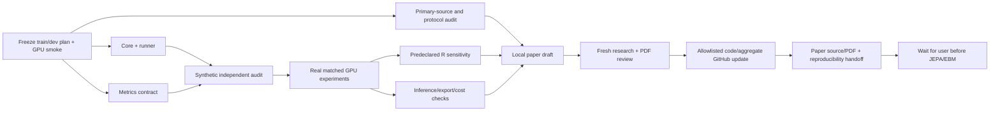

# Agentic workflow: selector study through paper

Activated by the user on2026-10-28. The active goal covers real GPU selector
experiments, audit, metrics, code/results publication and a complete local
exploratory paper. JEPA/EBM are outside this goal until the user approves later.

Coordinator owns the dependency graph, frozen plans, execution permissions,
integration and final decision. Coordinator model is supplied by runtime/UI;
there is no verified model-name API metadata. All spawned workers explicitly
use gpt-6.1-sol/xhigh or gpt-6-luna/xhigh with fork_turns=none, following the
user's newer model allowance. At most coordinator plus3 workers; no nested
spawning. Roles run in successive waves instead of creating an unbounded tree.

| Wave | Actual role/task | Model/effort | Owned output | Gate |
|---|---|---|---|---|
|1|selector_code|gpt-6.1-sol/xhigh|selector core/runner + synthetic tests|244 parameters, matched batches/init, CUDA execution, no final access|
|1|metrics_recorder|gpt-6.1-sol/xhigh|metrics module/tests/recording contract|paired user-level uncertainty, real emitted error, provenance and public/private boundary|
|1|research_auditor|gpt-6.1-sol/xhigh|source ledger and independent research/code audit|primary sources, falsifiable narrow claims, no causal/novelty overstatement|
|2|writer|gpt-6-luna/xhigh for structured draft|local paper sections using approved source/metrics ledger|no invented numbers/references, exploratory scope and sealed final|
|2|export/performance audit|gpt-6.1-sol/xhigh|full graph parity, operator/cost/latency report|actual400->20 inference and resource definitions, private artifacts|
|3|fresh paper/reproducibility reviewer|gpt-6.1-sol/xhigh|claim/table/source/reproduction review|correct arithmetic and inference, limitations, visual PDF inspection|
|3|github_committer|gpt-6-luna/xhigh|allowlisted commit/push and CI receipt|audited code/config/aggregate only; no data, identifiers, scalers or weights|

This table is a role schedule, not proof tasks have already run. Actual calls,
receipts, commits and review findings are recorded in the workspace workflow
log and private run directory. Reuse or replace completed slots as dependencies
clear; do not start blocked work merely to keep agents busy.

Completion requires actual results or explicitly documented failed hypotheses,
all essential ablations/controls, a source-backed manuscript with no pending
result placeholders, compilation and visual PDF review, private artifact
integrity receipts, an independent review response and successful repository
checks. Agent agreement or a positive development number is insufficient.

Latest user constraint keeps final users sealed through paper delivery. No
final-confirmatory success or equivalence is reported; all dev inference is
exploratory. Negative findings do not trigger architecture/holdout searches.
Do not change thresholds or hide variants. No paid compute, emails, registration,
competition submission or preprint posting is authorized. Paper remains local
for user review; GitHub gets code and audited aggregate results.
