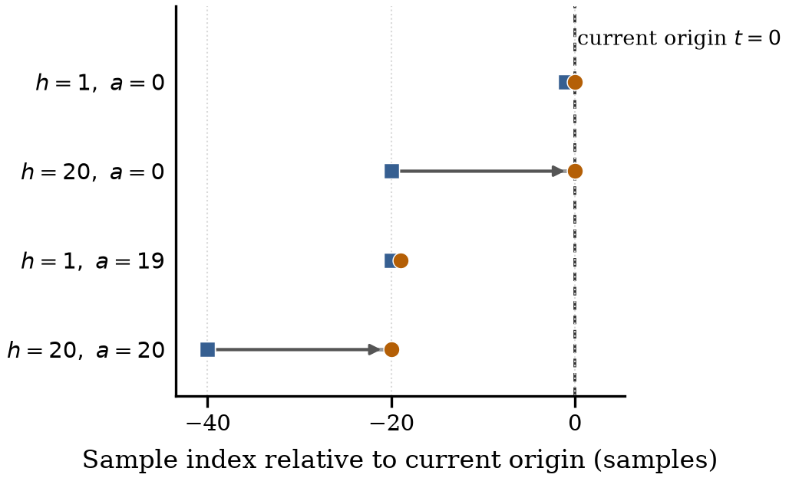
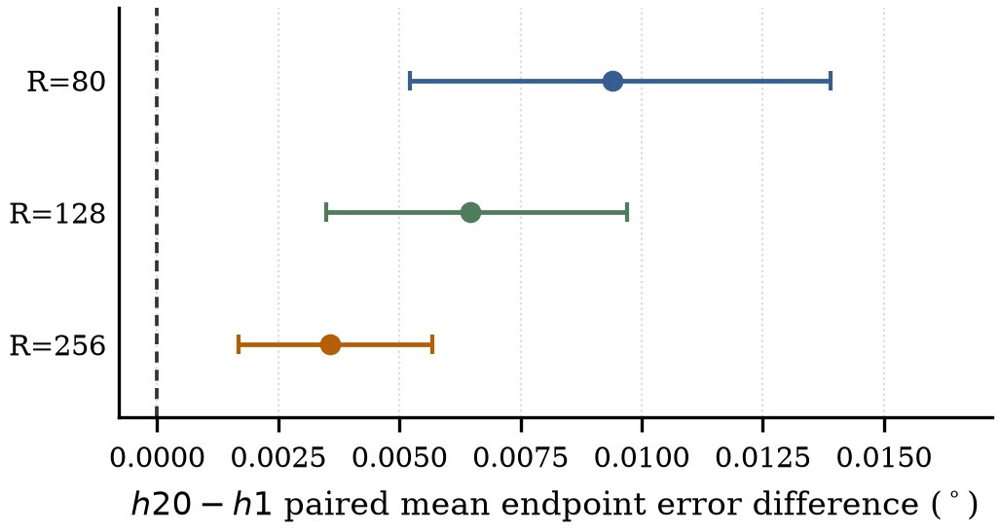

# Selector244: kết quả GPU train/dev và inference — 28/10/2026

Đã chạy **20 model fits trên RTX5050 Laptop**: 6 biến thể R80 ×2seeds và h1/h20
ở R128/R256 ×2seeds. Final15users giữ kín; đây là pilot WhoIsAlyx train/dev,
không phải điểm thi chính thức hoặc xác nhận hypothesis trên final.

## Kết quả chính R80

Endpoint20 mean geodesic error theo độ, thấp hơn tốt hơn. Mọi phương pháp dùng
cùng3.330.312train/1.189.027development windows và15train/5dev users. Mỗi learned
row là trung bình **lỗi** hai seeds, không phải ensemble prediction.

| Biến thể244params | Mean train° | Mean dev° | P95 dev° | CI95% mean dev° |
|---|---:|---:|---:|---|
| h1,a0 | 3.7624 | 4.2849 | 14.8533 | [3.7193, 4.8960] |
| h20,a0 | 3.7695 | 4.2943 | 14.8958 | [3.7245, 4.9099] |
| h1,a19 | 3.7722 | 4.2978 | 14.9106 | [3.7259, 4.9157] |
| h20,a20 | 3.7735 | 4.3010 | 14.9241 | [3.7273, 4.9202] |
| Complete-Horizon | 3.7704 | 4.2953 | 14.9000 | [3.7249, 4.9117] |
| Motion-only | 3.7185 | 4.2398 | 14.6304 | [3.6807, 4.8422] |
| Static mixture, fit train | 3.3138 | 3.7249 | 13.1185 | [3.2423, 4.2704] |

Primary h20−h1 = **+0,009396°**, paired user-cluster CI95%[+0,005227,+0,013899],
0/5users cải thiện. H20 so static mixture =+0,569353° [ +0,482226,+0,656647 ].
Không đạt lợi ích thực dụng>=3% và0,05°. Các khoảng tin cậy đều thăm dò trên5dev
users, conditional trên hai seeds; không kiểm định hoặc xác nhận final H1/equivalence.

## Data/compute đã khớp

10→16ReLU→4Softmax,244trainable parameters,224dense MACs. SGD2.000steps,
batch128,lr0,001,zero momentum/weightdecay,hai seeds20261026/27; clonedinitial
state và **cùng toàn bộ origin-index schedule** cho mọi variant/R trong từng
seed.256.000draws có lặp/model từ3.330.312trainwindows, không được gọi là
7,7%unique coverage. Feature/scaler fitting chỉ train; không devcheckpointselection.
Loss là expected individual-expert endpoint20 angle; metric là actual blend.

Data/compute matching áp dụng **giữa các selector/ablation**. Static mixture
cũ fit actual blend trên35simplex candidates/65.536train calibration windows;
MLP80k cũ dùng Adam/MSE và nhiều parameters hơn. Các family baseline không
được gọi là đã khớp training objective, capacity hoặc fitting compute.

## Độ nhạy R đã định trước

| R | Mean h1 dev° | Mean h20 dev° | h20−h1° | Paired CI95%° | Users cải thiện |
|---|---:|---:|---:|---|---:|
| 80 | 4.2849 | 4.2943 | +0.009396 | [+0.005227, +0.013899] | 0/5 |
| 128 | 4.2901 | 4.2965 | +0.006458 | [+0.003490, +0.009701] | 0/5 |
| 256 | 4.2960 | 4.2996 | +0.003575 | [+0.001684, +0.005676] | 0/5 |

Không chọn R tốt nhất sau kết quả. Các run này giữ nguyên dataset, model,
steps/batches/SGD/initial state/index schedules. Scope giai đoạn mới được ghi
trước selector fits trong [plan](selector_study_plan.md) và[sensitivity plan](selector_sensitivity_plan.md).
Learned h1,a19 là extension trước fits, sau khi baseline outcomes đã biết.
Wider analytic h×a grid và native-clock sensitivity trong thiết kế ban đầu
chưa chạy; không giả vờ đã hoàn thành chúng hoặc thay thế bằng resampling90Hz.

## Diagnostic và giới hạn khoa học

Post-hoc hard argmax của toàn bộ12R80fits chọnCAV_W1 trên100%train/devwindows.
Full-train expected loss h20=4,13784°, cao hơn fixed CAV_W1=3,56973°; hội tụ
chưa được chứng minh. Đây là failure case của recipe/budget này, không phải
bằng chứng rằng past-error evidence/h20 nói chung không có thông tin.

Static mixture có expected individual loss dev4,89434° nhưng actual blend
error3,72492°; learnedh20 có expected4,66565° nhưng actual4,29427°. Surrogate
thấp hơn không bảo đảm blend tốt hơn; không suy một bound toàn cục từ gap này.
Không thay loss/architecture, nới ngưỡng hoặc mở final để cứu kết quả.

## Tài nguyên và full graph

MainR80stage143,62giây; peak CUDA allocated928.942.592bytes (~886MiB),
reserved954.204.160bytes. GPUforward/backward và mọi parameters/gradients,
features,labels/lossđã được xác nhận CUDA thật. Scalar/geometry trong offline
metric vẫn tính riêng; GPUutilization thấp với model nhỏ không chứng minh CPU/GPU speedup.

Đã export6full stateless FP32 graphs: input[1,400,4]→output[1,20,4],opset17,
khôngLoop/If/Scan/NonZero/TopK/customops/float64. Chọn seed20261026 theo kế hoạch,
không chọn seed tốt nhất. Batch1ORTCPU1thread,warmup50,reps500,resident input,
không gồmfileIO. Các số sau là local laptop, không phải thiết bị XR của BTC.

| Graph R80 | Bytes | Nodes | ORT CPU median ms | ORT CPU P95 ms |
|---|---:|---:|---:|---:|
| h1_a0 | 56,218 | 605 | 0.4157 | 0.4885 |
| h20_a0 | 56,218 | 605 | 0.4220 | 0.5656 |
| h20_a20 | 56,218 | 605 | 0.4288 | 0.5231 |
| complete_horizon | 68,455 | 605 | 3.5903 | 5.8015 |
| motion_only | 45,725 | 530 | 0.1416 | 0.1651 |
| h1_a19 | 56,218 | 605 | 0.4386 | 0.6600 |

Full graph có thêm evidence/geometry/trig/indexing/scaling/Softmax. Ví dụh20
có28.726scalar Mul,19.284Add/Sub/reduction additions,15.676divisions,2.629Sqrt,
1.243Sin/Cos/Atan, **ngoài224dense MACs và20Gemm bias additions**. Full inventory
trong JSON; không biến các nhóm này thành một tổng MACs giả định cho hardware.

Sampling numerical parity **26contexts/user**,390train+130dev=520contexts,
khác all-window accuracy ở bảng trên. So eagerCPU,ORTCPU và resident eagerCUDA
với offlinefloat64reference: maxreal trajectory drift0,000138423°, maxabsolute
sampled partition mean endpoint-error change0,00000291619°, qnormdeviation<=1,71e-7.
Mọi gate định trước0,02°/0,01° đều đạt. Syntheticactual-checkpointmax0,000296934°.
EagerCUDA medians3,11–4,44ms dùng CUDAeventintervals và synchronizedwall riêng;
khácbackend/clock vớiORTCPU, không phảiORTCUDA hoặc so hardware thuần túy.
Chưa đo accuracy all-window của FP32graph, cleanLinuxtrainedartifact hoặcXRlatency.

Input400 được bảo toàn; activeR80history: h1/motion101observations,h20/CH/h1a19120,
h20a20140. Không nói mọi input400đều ảnh hưởng prediction. Không state hoặc
per-usergradient updates; mọi evidence target nằm ở hiện tại hoặc quá khứ.

## Reproduction và ranh giới công bố

Đọc [workflow](agentic_research_workflow.md),[audit](selector_research_audit.md),
[paper review](paper_evidence_review.md),[inference design](selector_inference_design.md),
[metrics contract](metrics_recording_contract.md) và các configs. Raw/cleaned data,
user manifests, scalers, features, errors theo từngwindow/user,weights vàONNX
chỉ nằm local dưới ignored `data/`. Paper cósource/PDF local cho tác giả review;
repo này không đăng manuscript/preprint.

Machine-readable aggregates: [mainR80](results/selector_main_R80.json),
[R sensitivity](results/selector_R_sensitivity.json),[inference](results/selector_inference_audit.json),
[posthoc diagnostics](results/selector_posthoc_diagnostics.json),[baseline trước](baseline_results_2026-10-28.json).

Alyx-only challenge eligibility, institutional duties và mâu thuẫn20samples/
100Hz/100ms còn unresolved. BOXRR không dùng khi thiếu recipient approval.
JEPA/EBM chưa triển khai/train; chờ người dùng đồng ý sau paper.
